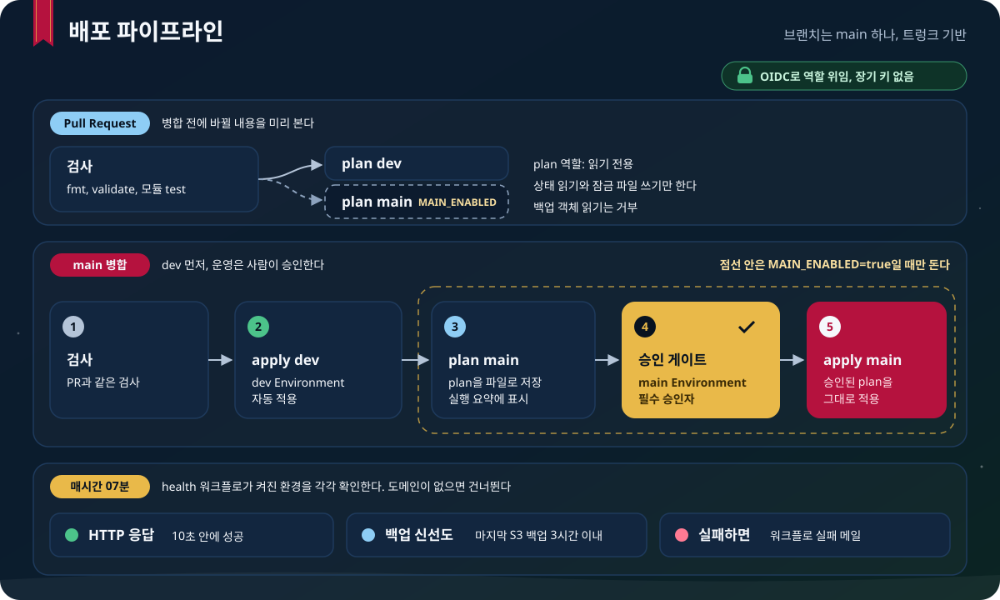
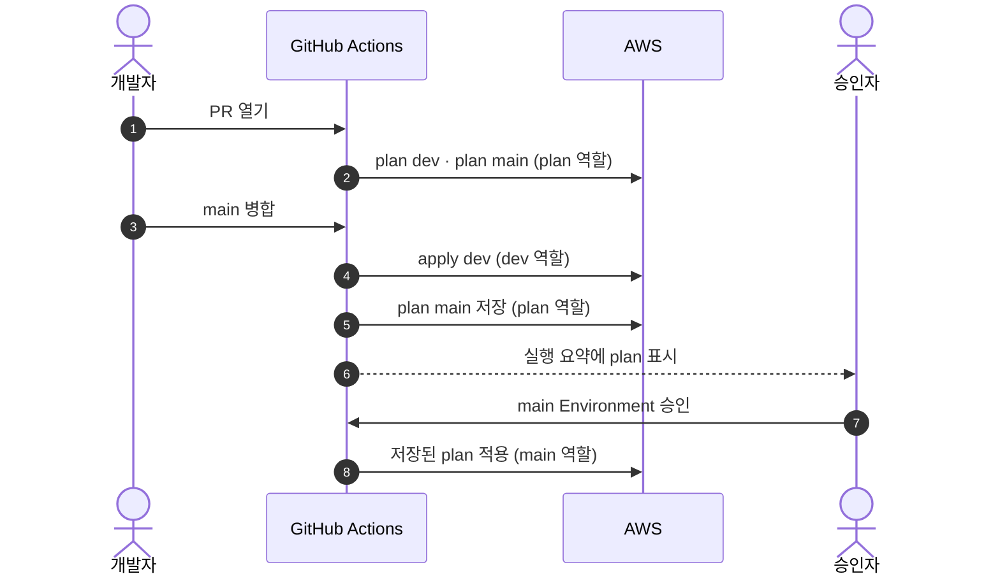
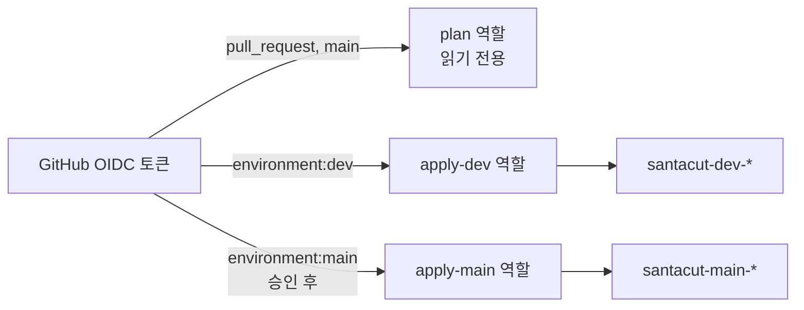

<p align="center">
  
</p>

<p align="center">
  <b>작게 시작하는 크리스마스 서비스 인프라.</b><br>
  인스턴스 한 대, 승인 한 번, 장기 키 0개.
</p>

<p align="center">
  
  
  
  
  
  
</p>

앱 코드는 [`yooni9ue/santacut`](https://github.com/yooni9ue/santacut)에 있다.

<p align="center"></p>

## 한눈에 보기

| 숫자 | 뜻 |
| :---: | --- |
| **1** | 지금 켠 환경. `dev`만 쓴다. `main`(운영)은 나중에 켠다 |
| **1** | 환경마다 인스턴스 한 대(512MB, 월 5달러) |
| **5** | GitHub OIDC 역할. plan, apply×2, 앱 배포×2 |
| **0** | 장기 액세스 키를 쓰는 CI 잡 |
| **약 8** | 월 고정비(USD, dev 한 환경 + KMS 키 2개) |
| **21일** | S3 백업 최대 보관 |
| **12/31** | 프로젝트 종료일. 이후 철거한다 |

| 선택 | 이유 |
| --- | --- |
| Lightsail | 고정 IP·전송량 포함 월 정액이다 |
| SQLite 유지 | 관리형 DB 고정비가 없다 |
| Bedrock Global 추론 | 서버에서 모델을 돌리지 않는다 |
| 같은 계정, IAM 분리 | 이름 접두사와 태그로 환경을 가른다 |
| 트렁크 기반 | 브랜치는 `main` 하나다 |

## 시즌 달력

산타컷은 크리스마스 시즌에만 여는 서비스다. 인프라도 시즌에 맞춰 열고 닫는다. 2026-11-16 기준으로 종료까지 D-45다.

| 날짜 | 할 일 |
| --- | --- |
| 2026-11-16 | bootstrap 적용. 상태는 S3로 옮겼다([운영 문서 1절](docs/operations.md#1-bootstrap-처음-한-번)) |
| 2026-12-31 | 프로젝트 종료. 모든 리소스의 `ExpiresOn` 태그 날짜다 |
| 철거 직후 7일 | KMS 키 삭제 대기. 이 기간에는 되살릴 수 있다 |
| 2027-01 중순 | Cost Explorer에서 서비스별 비용이 0인지 본다 |
| 2027-01-31 | 예산 알림 기간 끝(`budget_end`) |

철거 순서는 [운영 문서 13절](docs/operations.md#13-프로젝트-종료1231-철거-절차)에 있다.

## 아키텍처

<p align="center"></p>

- 요청은 Route 53 → 고정 IP → Caddy(TLS) → Spring Boot 순서다.
- 도메인을 사기 전에는 고정 IP에 HTTP로 접속한다. Route 53은 쓰지 않는다.
- SQLite는 인스턴스 디스크에 있다.
- 디스크는 매일 03:00(KST) 자동 스냅숏을 뜬다.
- DB 백업은 S3에 따로 올린다. 버킷이 환경별 KMS 키로 암호화한다(SSE-KMS).
- 백업은 14일 뒤 이전 버전이 되고, 7일 뒤 영구 삭제된다. 그래서 최대 21일 남는다.
- 앱 설정(`.env`)도 KMS로 암호화해 S3에 두고, 부팅 때 tmpfs로 받는다.
- AI 점수는 Bedrock Claude Haiku 5.5가 낸다.

## 배포 파이프라인

<p align="center"></p>



- 운영 잡(PR의 main plan, `plan-main`, `apply-main`)은 레포 변수 `MAIN_ENABLED=true`일 때만 돈다.
- 운영에는 승인자가 본 plan이 그대로 적용된다.
- 매시간 HTTP 응답과 백업 신선도를 확인한다. 도메인이 없으면 이 확인은 건너뛴다.
- 실패하면 워크플로 실패 메일이 간다.

## 보안·격리

<p align="center"></p>



- 역할은 OIDC `sub` 조건으로만 맡는다.
- apply 역할은 자기 상태 키만 쓴다.
- 앱 사용자는 권한 경계를 넘지 못한다.
- 앱 사용자는 자기 환경 KMS 키를 S3를 거쳐서만 쓴다. 설정(`config/`)은 읽기만 한다.
- 비밀값은 레포, 워크플로, Terraform 상태에 없다. 인스턴스 디스크의 평문 비밀값은 앱 액세스 키 하나다.
- `SSH_ALLOWED_CIDRS`는 22번만 제한한다. 80/443은 모두에게 열려 있다.
- IAM으로 못 막는 위험은 [운영 문서 4절](docs/operations.md#iam으로-막지-못하는-위험)에 있다.

## 예상 월 비용

<p align="center"></p>

지금은 dev 한 환경만 켜고 도메인이 없다.

| 항목 | 월 비용(USD) | 근거 |
| --- | ---: | --- |
| Lightsail `nano_3_0` × 1 | 5 | 512MB·2 vCPU·20GB, 공인 IPv4 포함. `get-bundles`로 서울 가격 확인 |
| 자동 스냅숏 | 약 0.5 | GB당 0.05, 증분(추정) |
| Route 53 호스팅 영역 | 0 | 도메인을 산 뒤 0.5 |
| S3(상태·백업) | 1 미만 | 수 GB 이하 |
| KMS 키 × 2 | 약 2 | 키당 월 1. 키가 있는 동안 과금, 삭제 후 7일 대기. 요청 요금은 버킷 키로 줄인다 |
| GitHub Actions | 0 | 공개 레포 표준 러너 |
| **고정비 합계** | **약 8** | |
| Bedrock Claude Haiku 4.5 | 최대 10 | 사용량 비례. 예산 10달러를 넘으면 앱 사용자에 거부 정책이 자동으로 붙는다 |

나중에 도메인을 사고 `main`까지 켜면 고정비는 약 14~15달러다(인스턴스 5 × 2, KMS 2, 스냅숏 약 1, Route 53 0.5, S3 1 미만). KMS 키는 bootstrap이 두 환경 몫을 미리 만든다.

<details>
<summary>Bedrock 비용 방어</summary>

- 앱에는 하루 AI 호출 한도가 없다. 비용은 예산으로만 막는다.
- Bedrock 예산은 월 10달러다(`bootstrap/budget.tf`).
- 실제 비용이 100%를 넘으면 dev 앱 IAM 사용자에 Bedrock 거부 정책이 자동으로 붙는다(`enable_bedrock_stop = true`).
- 해제 절차는 [운영 문서 10절](docs/operations.md#10-bedrock-예산-차단과-해제)에 있다.
- 예산 데이터는 하루에 몇 번만 갱신된다. 차단은 몇 시간 늦을 수 있다.
- 사용자당 24시간 3회 제출 제한이 남아 있어 갑자기 크게 늘지는 않는다.

</details>

- 예산 알림: 계정 20달러, Bedrock 10달러(`bootstrap/budget.tf`).
- 512MB는 Caddy와 Spring에 빠듯하다. 1GB 스왑을 두고 JVM 힙을 제한한다([운영 문서 6단계](docs/operations.md#512mb-번들의-메모리)).
- 사양을 올리려면 `bundle_id`를 바꾼다. 인스턴스 교체 절차를 따른다([운영 문서 9절](docs/operations.md#인스턴스-교체-사양-올리기-장애-복구)).
- Lightsail은 멈춰도 요금이 나간다.
- dev가 필요 없으면 내린다([운영 문서 11절](docs/operations.md#11-dev-내리기)).
- 프로젝트는 2026-12-31에 끝난다. 모든 리소스에 `ExpiresOn` 태그가 있다. 철거는 [운영 문서 13절](docs/operations.md#13-프로젝트-종료1231-철거-절차)을 따른다.

## 디렉터리 구조

```text
santacut-infra/
├─ bootstrap/              # 계정에 한 번: 상태 버킷, OIDC 역할, KMS 키, Route 53, 예산
├─ modules/santacut_app/   # 환경 하나: 인스턴스, 고정 IP, 방화벽, 백업 버킷, 앱 IAM
├─ envs/
│  ├─ dev/                 # dev 루트 모듈
│  └─ main/                # 운영 루트 모듈
├─ scripts/put-secrets.sh  # 앱 설정을 KMS로 암호화해 S3에 올린다
├─ .github/workflows/      # terraform.yml, health.yml
└─ docs/operations.md      # 설정·운영·복구 절차
```

## 빠른 시작

처음 설정은 [`docs/operations.md`](docs/operations.md) 1~7단계를 따른다.

1. bootstrap을 적용한다(KMS 키 포함). 도메인이 없으면 비워 둔다. 환경보다 먼저 적용해야 한다.
2. 도메인을 샀다면 가비아 네임서버를 위임한다.
3. Bedrock 모델을 활성화한다.
4. GitHub 변수와 Environment를 설정한다.
5. PR을 병합해 dev를 적용한다. `main`은 `MAIN_ENABLED=true`일 때만 적용된다.

## 검증

```sh
terraform fmt -check -recursive
for d in bootstrap envs/dev envs/main; do terraform -chdir=$d init -backend=false && terraform -chdir=$d validate; done
terraform -chdir=modules/santacut_app init -backend=false && terraform -chdir=modules/santacut_app test
```

<p align="center"></p>
