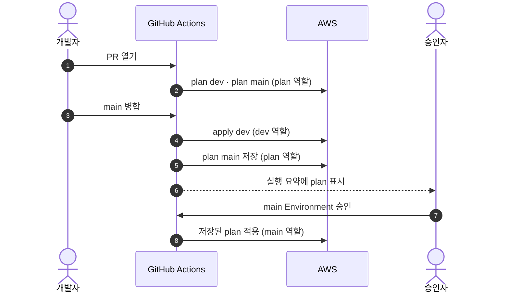
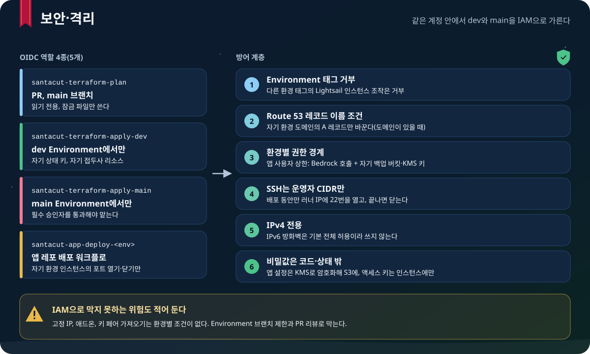
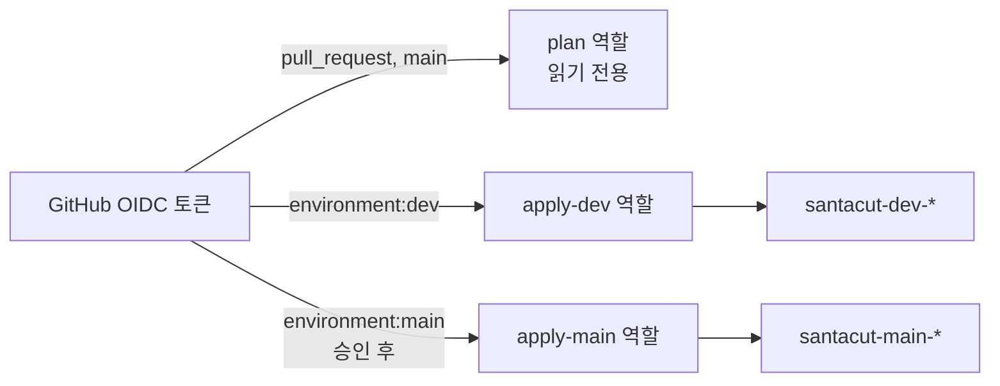
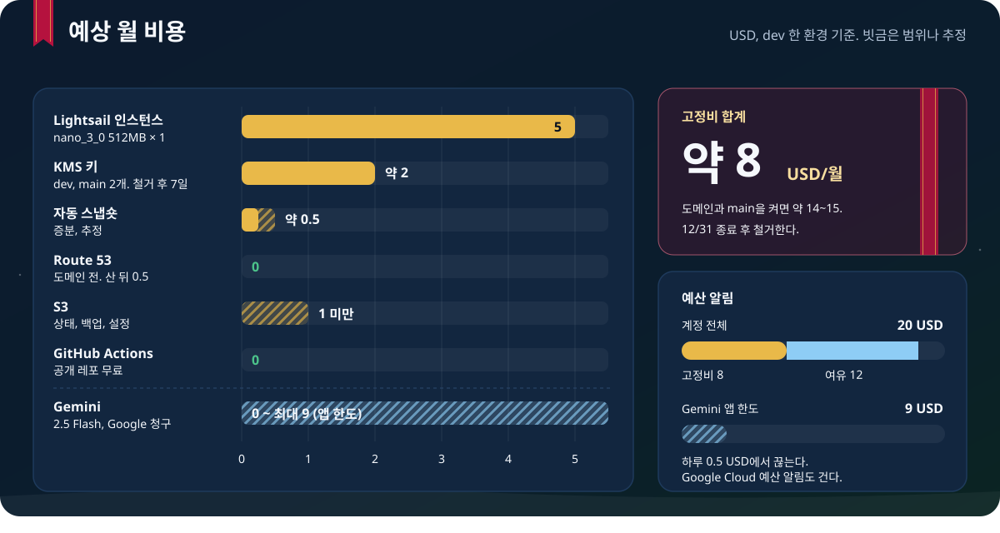

<p align="center">
  
</p>

<p align="center">
  <b>작게 시작하는 크리스마스 서비스 인프라.</b><br>
  인스턴스 한 대, 승인 한 번, 장기 키 0개.
</p>

<p align="center">
  
  
  
  
  
  
</p>

앱 코드는 [`yooni9ue/santacut`](https://github.com/yooni9ue/santacut)에 있다.

<p align="center"></p>

## 한눈에 보기

| 숫자 | 뜻 |
| :---: | --- |
| **1** | 지금 켠 환경. `dev`만 쓴다. `main`(운영)은 나중에 켠다 |
| **1** | 환경마다 인스턴스 한 대(`micro_3_0` 1GB, 월 7달러) |
| **5** | GitHub OIDC 역할. plan, apply×2, 앱 배포×2 |
| **0** | 장기 액세스 키를 쓰는 CI 잡 |
| **약 11** | 월 고정비(USD, dev 한 환경 + KMS 키 2개 + Route 53) |
| **매시** | SQLite를 S3에 백업(SSE-KMS, 최대 21일). 디스크 스냅숏은 매일 |
| **12/31** | 프로젝트 종료일. 이후 철거한다 |

| 선택 | 이유 |
| --- | --- |
| Lightsail | 고정 IP·전송량 포함 월 정액이다 |
| SQLite 유지 | 관리형 DB 고정비가 없다 |
| Gemini API | 서버에서 모델을 돌리지 않는다 |
| 같은 계정, IAM 분리 | 이름 접두사와 태그로 환경을 가른다 |
| 트렁크 기반 | 브랜치는 `main` 하나다 |

## 시즌 달력

산타컷은 크리스마스 시즌에만 여는 서비스다. 인프라도 시즌에 맞춰 열고 닫는다. 2026-11-17 기준으로 종료까지 D-44다.

| 날짜 | 할 일 |
| --- | --- |
| 2026-11-16 | bootstrap 적용. 상태는 S3로 옮겼다([운영 문서 1절](docs/operations.md#1-bootstrap-처음-한-번)). dev를 `micro_3_0`으로 올리고 `santacut.me`를 Route 53에 위임했다 |
| 2026-12-31 | 프로젝트 종료. 모든 리소스의 `ExpiresOn` 태그 날짜다 |
| 철거 직후 7일 | KMS 키 삭제 대기. 이 기간에는 되살릴 수 있다 |
| 2027-01 중순 | Cost Explorer에서 서비스별 비용이 0인지 본다 |
| 2027-01-31 | 예산 알림 기간 끝(`budget_end`) |

철거 순서는 [운영 문서 13절](docs/operations.md#13-프로젝트-종료1231-철거-절차)에 있다.

## 아키텍처

<p align="center"></p>

- 요청은 Route 53 → 고정 IP → Caddy(HTTPS) → Spring Boot 순서다. Caddy가 Let's Encrypt 인증서를 받아 HTTPS를 끝내고, HTTP는 HTTPS로 넘기며 HSTS를 붙인다.
- SQLite는 인스턴스 디스크에 있다. 디스크는 매일 03:00(KST) 자동 스냅숏을 뜬다.
- DB는 매시 S3 `backups/`에도 올린다(`backup.sh`, cron). 버킷이 환경별 KMS 키로 암호화한다(SSE-KMS). 14일 뒤 이전 버전이 되고 7일 뒤 영구 삭제되어 최대 21일 남는다.
- AI 점수는 Google Gemini 3.5 Flash-Lite가 낸다. AWS 밖의 서비스라 IAM 권한이 없다. Bedrock은 쓰지 않는다.

### 도메인

`santacut.me`는 가비아에서 샀고, 네임서버를 Route 53 호스팅 영역(bootstrap)으로 위임했다.

| 이름 | 가리키는 곳 | 만드는 곳 |
| --- | --- | --- |
| `api-dev.santacut.me` | dev 고정 IP(A) | `envs/dev` |
| `api.santacut.me` | main 고정 IP(A). main을 켜면 생긴다 | `envs/main` |
| `santacut.me`, `www.santacut.me` | Vercel 운영 화면 | `bootstrap/dns.tf` |
| `dev.santacut.me` | Vercel dev 화면 | `bootstrap/dns.tf` |

### 비밀값 흐름

- 앱 설정(`app.env`)은 운영자 PC에서 `scripts/put-secrets.sh`로 환경별 KMS 키로 암호화해 S3 `config/app.env`에 올린다. 레포, 워크플로, Terraform 상태에는 들어가지 않는다.
- 여기에는 `GEMINI_API_KEY`, 도메인·CORS 설정, 그리고 비공개 GHCR 이미지를 받을 `GHCR_USER`, `GHCR_TOKEN`(`read:packages`만)이 들어간다.
- 인스턴스는 부팅 때 `santacut-secrets.service`가 `fetch-secrets.sh`로 이 파일을 tmpfs `/run/santacut/app.env`(600)에 받는다. GHCR 두 키로 `docker login ghcr.io`를 하고, 앱 컨테이너에 넘기는 파일에서는 두 키를 뺀다.
- 인스턴스 디스크의 평문 비밀값은 앱 IAM 사용자 액세스 키 하나다(`/opt/santacut/aws/credentials`).

## 배포 파이프라인

<p align="center"></p>



- 운영 잡(PR의 main plan, `plan-main`, `apply-main`)은 레포 변수 `MAIN_ENABLED=true`일 때만 돈다.
- 운영에는 승인자가 본 plan이 그대로 적용된다.

### 앱 배포(앱 레포)

- `develop` 푸시: 앱 레포 CI가 테스트 → GHCR 이미지 게시 → dev 배포를 한다. `santacut-app-deploy-dev` 역할을 OIDC로 맡아 러너 IP에만 22번을 열고, 검증한 이미지 digest로 바꾼 뒤 포트를 닫는다.
- `main` 푸시: 이미지 게시까지만 한다. 운영 배포는 앱 레포의 수동 실행(`deploy=true`)이다.

### 관측과 알람

| 무엇 | 언제 | 알림 |
| --- | --- | --- |
| `health.yml`: `https://api-dev.santacut.me` 응답과 마지막 S3 백업(3시간 이내) | 매시 07분 | 워크플로 실패 메일 |
| Lightsail 알람 `santacut-dev-status`(상태 확인 실패), `santacut-dev-burst`(버스트 용량 20% 이하) | 상태 확인 실패 2번, 버스트 3번 연속 | 메일(CLI로 건다, 연락처 인증 필요) |
| AWS Budgets | 계정 월 20달러 | 메일 |

자세한 절차는 [운영 문서 8절](docs/operations.md#8-관측과-알람)에 있다.

## 보안·격리

<p align="center"></p>



- 역할은 OIDC `sub` 조건으로만 맡는다.
- apply 역할은 자기 상태 키만 쓴다.
- 앱 사용자는 권한 경계를 넘지 못한다.
- 앱 사용자는 자기 환경 KMS 키를 S3를 거쳐서만 쓴다. 설정(`config/`)은 읽기만 한다.
- 비밀값은 레포, 워크플로, Terraform 상태에 없다. 인스턴스 디스크의 평문 비밀값은 앱 액세스 키 하나다.
- `SSH_ALLOWED_CIDRS`는 22번만 제한한다. 80/443은 모두에게 열려 있다.
- IAM으로 못 막는 위험은 [운영 문서 4절](docs/operations.md#iam으로-막지-못하는-위험)에 있다.

## 예상 월 비용

<p align="center"></p>

지금은 dev 한 환경만 켰다.

| 항목 | 월 비용(USD) | 근거 |
| --- | ---: | --- |
| Lightsail `micro_3_0` × 1 (dev) | 7 | 1GB·2 vCPU·40GB, 공인 IPv4 포함. 2026-11-16에 512MB에서 올렸다(기동 212초 → 26초). `get-bundles`로 서울 가격 확인 |
| 자동 스냅숏 | 약 0.5 | GB당 0.05, 증분(추정) |
| Route 53 호스팅 영역 | 0.5 | `santacut.me` 하나. 질의 요금은 미미하다 |
| S3(상태·백업·설정) | 1 미만 | 수 GB 이하 |
| KMS 키 × 2 | 약 2 | 키당 월 1. 키가 있는 동안 과금, 삭제 후 7일 대기. 요청 요금은 버킷 키로 줄인다 |
| GitHub Actions | 0 | 공개 레포 표준 러너 |
| **고정비 합계** | **약 11** | |
| Gemini 3.5 Flash-Lite (Google 청구) | 최대 9 | 사용량 비례. 앱이 한 달 9달러에서 끊는다. 하루 한도는 기본으로 없다 |

`main`까지 켜면 고정비는 약 18~19달러다(인스턴스 7 × 2, 스냅숏 약 1, KMS 2, Route 53 0.5, S3 1 미만). KMS 키는 bootstrap이 두 환경 몫을 미리 만든다.

<details>
<summary>AI 비용 방어</summary>

- Gemini 비용은 Google이 청구한다. AWS 예산에는 잡히지 않는다.
- 1차 방어는 앱 자체 한도다. 호출 전에 비용을 어림해 한 달 9달러를 넘으면 부르지 않는다.
- Gemini는 선불 크레딧으로 쓴다. 크레딧이 떨어지면 Gemini가 `429`로 막고, 앱은 작업을 실패시키지 않고 대기열에 둔 채 15분씩 쉰다. 크레딧을 채우면 이어서 처리한다.
- 운영자가 Google Cloud 결제 예산 알림을 직접 건다. 알림만 보내고 호출을 막지는 않는다.
- 사용자당 24시간 3회 제출 제한도 있다.
- 자세한 내용은 [운영 문서 10절](docs/operations.md#10-ai-비용-보호-gemini)에 있다.

</details>

- AWS 예산 알림: 계정 20달러(`bootstrap/budget.tf`). AWS 비용만 본다.
- 사양을 올리려면 `bundle_id`를 바꾼다. 인스턴스 교체 절차를 따른다([운영 문서 9절](docs/operations.md#인스턴스-교체-사양-올리기-장애-복구)).
- Lightsail은 멈춰도 요금이 나간다.
- dev가 필요 없으면 내린다([운영 문서 11절](docs/operations.md#11-dev-내리기)).
- 프로젝트는 2026-12-31에 끝난다. 모든 리소스에 `ExpiresOn` 태그가 있다. 철거는 [운영 문서 13절](docs/operations.md#13-프로젝트-종료1231-철거-절차)을 따른다. Terraform 밖에서 만든 것(앱 액세스 키, Lightsail 알람·연락처, Google 예산 알림, 수동 스냅숏)도 함께 지운다.

## 디렉터리 구조

```text
santacut-infra/
├─ bootstrap/              # 계정에 한 번: 상태 버킷, OIDC 역할, KMS 키, Route 53, 예산
├─ modules/santacut_app/   # 환경 하나: 인스턴스, 고정 IP, 방화벽, 백업 버킷, 앱 IAM
├─ envs/
│  ├─ dev/                 # dev 루트 모듈
│  └─ main/                # 운영 루트 모듈
├─ scripts/put-secrets.sh  # 앱 설정을 KMS로 암호화해 S3에 올린다
├─ .github/workflows/      # terraform.yml, health.yml
└─ docs/operations.md      # 설정·운영·복구 절차
```

## 빠른 시작

처음 설정은 [`docs/operations.md`](docs/operations.md) 1~7단계를 따른다.

1. bootstrap을 적용한다(KMS 키, Route 53 영역 포함). 환경보다 먼저 적용해야 한다.
2. 가비아에서 네임서버를 Route 53 영역으로 위임한다(`santacut.me`는 마쳤다).
3. Gemini API 키를 받고 개인정보 국외 이전 고지를 준비한다. 키와 GHCR 키를 `app.env`에 넣어 `scripts/put-secrets.sh`로 올린다.
4. GitHub 변수와 Environment를 설정한다.
5. PR을 병합해 dev를 적용한다. `main`은 `MAIN_ENABLED=true`일 때만 적용된다.

## 검증

```sh
terraform fmt -check -recursive
for d in bootstrap envs/dev envs/main; do terraform -chdir=$d init -backend=false && terraform -chdir=$d validate; done
terraform -chdir=modules/santacut_app init -backend=false && terraform -chdir=modules/santacut_app test
```

<p align="center"></p>
