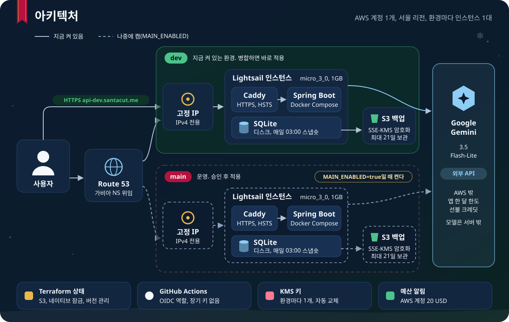
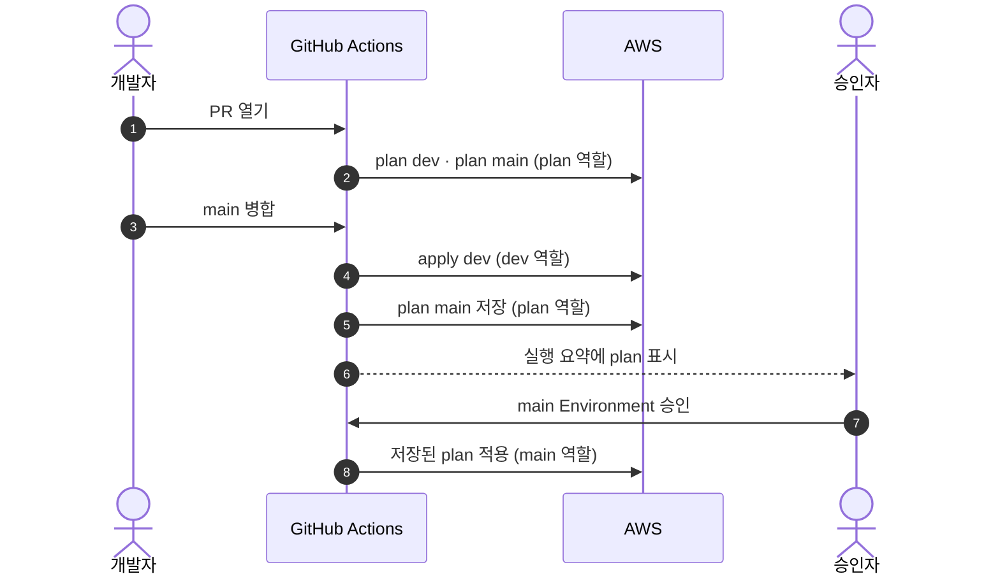
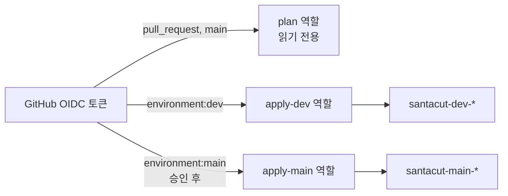

<p align="center">
  
</p>

<p align="center">
  <b>작게 시작하는 크리스마스 서비스 인프라.</b><br>
  인스턴스 한 대, 승인 한 번, 장기 키 0개.
</p>

<p align="center">
  
  
  
  
  
</p>

앱 코드는 [`yooni9ue/santacut`](https://github.com/yooni9ue/santacut)에 있다.

---

## 한눈에 보기

| 숫자 | 뜻 |
| :---: | --- |
| **1** | 지금 켠 환경. `dev`만 쓴다. `main`(운영)은 나중에 켠다 |
| **1** | 환경마다 인스턴스 한 대(512MB, 월 5달러) |
| **5** | GitHub OIDC 역할. plan, apply×2, 앱 배포×2 |
| **0** | 장기 액세스 키를 쓰는 CI 잡 |
| **약 6** | 월 고정비(USD, dev 한 환경) |
| **37일** | S3 백업 최대 보관 |

| 선택 | 이유 |
| --- | --- |
| Lightsail | 고정 IP·전송량 포함 월 정액이다 |
| SQLite 유지 | 관리형 DB 고정비가 없다 |
| Bedrock Global 추론 | 서버에서 모델을 돌리지 않는다 |
| 같은 계정, IAM 분리 | 이름 접두사와 태그로 환경을 가른다 |
| 트렁크 기반 | 브랜치는 `main` 하나다 |

## 아키텍처

<p align="center"></p>

- 요청은 Route 53 → 고정 IP → Caddy(TLS) → Spring Boot 순서다.
- 도메인을 사기 전에는 고정 IP에 HTTP로 접속한다. Route 53은 쓰지 않는다.
- SQLite는 인스턴스 디스크에 있다.
- 디스크는 매일 03:00(KST) 자동 스냅숏을 뜬다.
- DB는 age로 암호화해 S3에 따로 올린다.
- AI 점수는 Bedrock Claude Haiku 5.5가 낸다.

## 배포 파이프라인

<p align="center"></p>



- 운영에는 승인자가 본 plan이 그대로 적용된다.
- 매시간 HTTP 응답과 백업 신선도를 확인한다.
- 실패하면 워크플로 실패 메일이 간다.

## 보안·격리

<p align="center"></p>



- 역할은 OIDC `sub` 조건으로만 맡는다.
- apply 역할은 자기 상태 키만 쓴다.
- 앱 사용자는 권한 경계를 넘지 못한다.
- IAM으로 못 막는 위험은 [운영 문서 4절](docs/operations.md#iam으로-막지-못하는-위험)에 있다.

## 비용

<p align="center"></p>

지금은 dev 한 환경만 켜고 도메인이 없다.

| 항목 | 월 비용(USD) | 근거 |
| --- | ---: | --- |
| Lightsail `nano_3_0` × 1 | 5 | 512MB·2 vCPU·20GB, 공인 IPv4 포함. `get-bundles`로 서울 가격 확인 |
| 자동 스냅숏 | 약 0.5 | GB당 0.05, 증분(추정) |
| Route 53 호스팅 영역 | 0 | 도메인을 산 뒤 0.5 |
| S3(상태·백업) | 1 미만 | 수 GB 이하 |
| GitHub Actions | 0 | 공개 레포 표준 러너 |
| **고정비 합계** | **약 6** | |
| Bedrock Claude Haiku 5.5 | 상한 약 1.7 | 추정, 아래 참고 |

나중에 도메인을 사고 `main`까지 켜면 고정비는 약 12~13달러다(인스턴스 5 × 2, 스냅숏 약 1, Route 53 0.5, S3 1 미만).

<details>
<summary>Bedrock 상한 계산</summary>

- 하루 100회 × 30일 × 1환경(dev) = 월 3,000회.
- 호출당 입력 3,000토큰, 출력 500토큰으로 가정한다.
- Anthropic API 단가(100만 토큰당 입력 0.10, 출력 0.50)를 쓴다.
- 회당 약 0.00055달러, 월 약 1.7달러다. `main`을 켜면 두 배다.
- **미확인:** Bedrock 단가와 서울 리전 Global 프로파일 제공 여부.
- 첫 달 Cost Explorer로 확인한다.

</details>

- 예산 알림: 계정 20달러, Bedrock 10달러(`bootstrap/budget.tf`).
- 512MB는 Caddy와 Spring에 빠듯하다. 1GB 스왑을 두고 JVM 힙을 제한한다([운영 문서 6단계](docs/operations.md#512mb-번들의-메모리)).
- 사양을 올리려면 `bundle_id`를 바꾼다. 인스턴스 교체 절차를 따른다([운영 문서 9절](docs/operations.md#인스턴스-교체-사양-올리기-장애-복구)).
- Lightsail은 멈춰도 요금이 나간다.
- dev가 필요 없으면 내린다([운영 문서 11절](docs/operations.md#11-dev-내리기)).

## 디렉터리 구조

```text
santacut-infra/
├─ bootstrap/              # 계정에 한 번: 상태 버킷, OIDC 역할, Route 53, 예산
├─ modules/santacut_app/   # 환경 하나: 인스턴스, 고정 IP, 방화벽, 백업 버킷, 앱 IAM
├─ envs/
│  ├─ dev/                 # dev 루트 모듈
│  └─ main/                # 운영 루트 모듈
├─ .github/workflows/      # terraform.yml, health.yml
└─ docs/operations.md      # 설정·운영·복구 절차
```

## 빠른 시작

처음 설정은 [`docs/operations.md`](docs/operations.md) 1~7단계를 따른다.

1. bootstrap을 적용한다. 도메인이 없으면 비워 둔다.
2. 도메인을 샀다면 가비아 네임서버를 위임한다.
3. Bedrock 모델을 활성화한다.
4. GitHub 변수와 Environment를 설정한다.
5. PR을 병합해 dev를 적용한다. `main`은 `MAIN_ENABLED=true`일 때만 적용된다.

## 검증

```sh
terraform fmt -check -recursive
for d in bootstrap envs/dev envs/main; do terraform -chdir=$d init -backend=false && terraform -chdir=$d validate; done
terraform -chdir=modules/santacut_app init -backend=false && terraform -chdir=modules/santacut_app test
```
